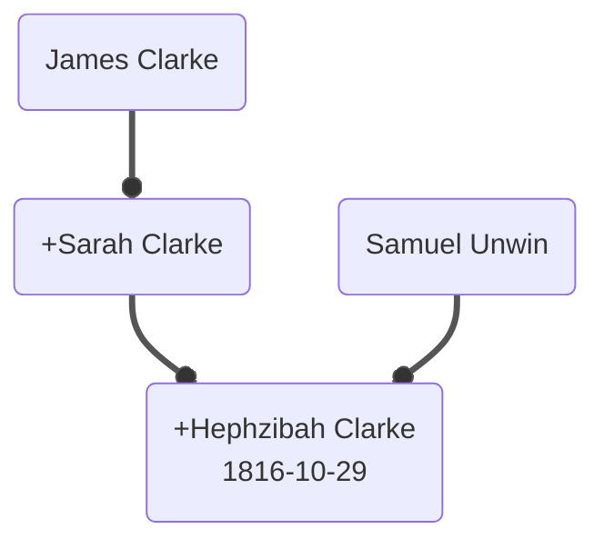

# Family Tree v2 Structure - JSON and Mermaid

## Overview

v2 stores each family branch as structured JSON and renders it as a Mermaid diagram. A combined JSON and a combined diagram merge all branches into one family network. Person data is queryable, combinable, and suitable for generating diagrams automatically.

## Per-Branch JSON

Each branch JSON file is an array of person records.

### Person Record Fields

| Field | Type | Description |
|-------|------|-------------|
| `id` | string | Unique person ID (see ID conventions) |
| `name` | object | `full`, `firstname`, `middle-name`, `surname`, `maiden_name` |
| `gender` | string | `M`, `F`, or `U` |
| `occupation` | string | Profession or trade |
| `birth` | object | `date`, `place` |
| `died` | object | `date`, `place`, `burial` |
| `spouses` | array | Marriage records in order: `id`, `marriedYear`, `marriedDate`, `marriedPlace`, `main` |
| `children` | array | Child person IDs |
| `parents` | object | `father` and `mother` person IDs |
| `original-info` | string | Original v1 text before any extraction |
| `remaining-info` | string | Text left after structured extraction |
| `fix` | object | Known gaps to resolve (missing birthday, death, parents) |
| `sources` | array | Source references (baptism, census, directory records) |
| `crossBranch` | array | Links to persons in other branches: `branch`, `id`, `relationship` |

### ID Conventions

| Case | Format | Example |
|------|--------|---------|
| Known birth year, male or unmarried female | `{year}_{firstname}_{surname}` | `1816_hephzibah_clarke` |
| Known birth year, female with maiden name | `{year}_{firstname}__{maiden_name}` | `1803_fanny__hone` |
| Estimated interval, female with maiden name | `{year1}_{year2}__{firstname}__{maiden_name}` | `1776_1814__sarah_clarke` |
| Estimated interval, male | `{year1}_{year2}__{firstname}_{surname}` | `1776_1814__james_clarke` |
| Unknown birth year | `xxxx_` prefix | `xxxx_samuel_unwin` |

Interval IDs are estimated from relatives' known birth years: parents approximately 20-40 years earlier, spouses in a similar range, children approximately 20-40 years later. Modern dates (after 1950) are excluded for historical persons.

### Name Handling

Females keep the maiden name as `surname` and in `maiden_name`. Diagram labels show the maiden name after a `~` separator (e.g. `Fanny ~Hone`). The `main` flag in a spouse record marks the primary marriage used for diagram layout.

### Info Text Handling

The v1 free text is split during conversion:

- Dates, places, and relationships move into structured fields.
- `s of` / `d of` phrases move into `parents`.
- Baptism, burial, and census references move into `sources`.
- `original-info` preserves the raw v1 text; `remaining-info` holds what is left after extraction.

## Mermaid Diagrams

### Syntax

- Branch diagrams use `flowchart TD`; the combined diagram uses `flowchart LR`.
- Nodes are defined inline on their first edge: `id(Label birthdate)`.
- Spouse edge: `parent1 ==o +parent2` — the `+` prefix marks parent2 (the spouse on the right/incoming side).
- Parent-child edge: `parent ==o child` — no `+`.
- Every diagram ends with `linkStyle default stroke:#555`.

### Edge Constraints

1. Every node has at least one edge.
2. Each node appears on the right/incoming side (`+`) at most once.
3. A node may have multiple left/outgoing edges (several children, several spouses' subtrees).
4. Non-root and non-leaf nodes have at least two edges in total.

### Example

Reading: James Clarke and Sarah Clarke are spouses. Their daughter Hephzibah Clarke (born 1816-10-29) carries the subtree. Hephzibah's spouse is Samuel Unwin (birth year unknown).

## Combined Files

The combined JSON merges all branch records by person ID. When the same person appears in multiple branches, `original-info`, `remaining-info`, places, and occupations are concatenated. Duplicate persons are merged with fuzzy birthday matching (plus or minus one year). The combined diagram contains every person from every branch, with subtrees connected through common persons.
